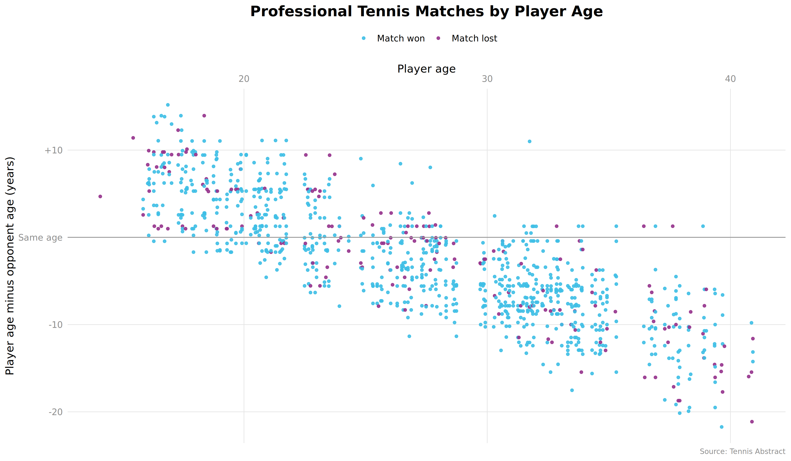
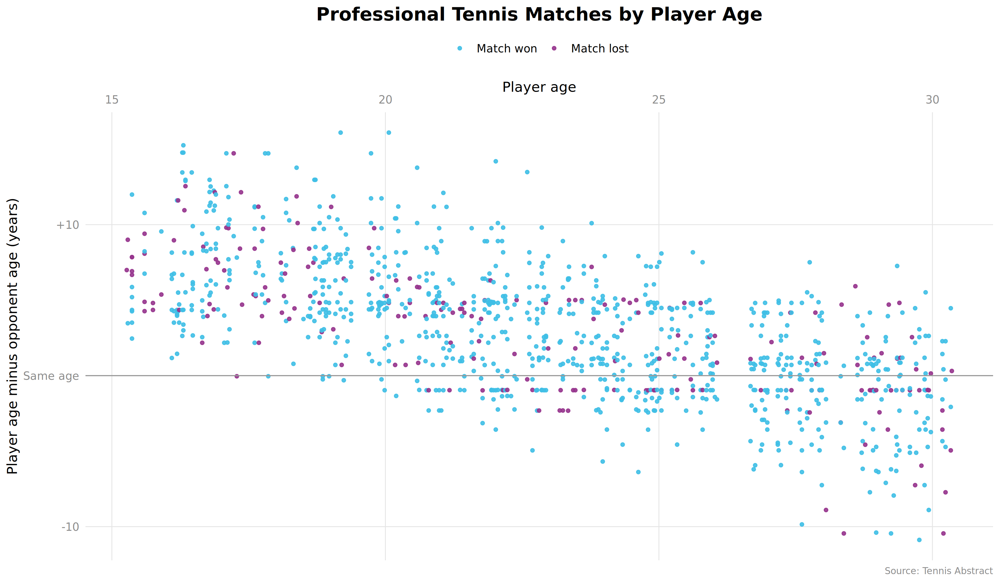

# tennismatchr

## Overview

This R package was created for STAT 159 Homework 3 at UC Berkeley. This assignment is a continuation of HW1 and HW2.

The purpose of this package is to retrieve professional tennis players' career match data from Tennis Abstract and create scatter plots similar to The New York Times visualization of Serena Williams's career matches.

The package allows users to enter a tennis player's name, retrieve their career match data, calculate the age differences between the player and their opponents, and create a scatter plot.

## Main Functions

The package has two main public functions.

### 1. `get_career_data()`

This function retrieves and cleans a tennis player's career match data from Tennis Abstract.

- **Input:** A tennis player's name.
- **Output:** A data frame containing the player's career matches and age differences.
- **Error handling:** Returns a meaningful error message if the player cannot be found.

The function accepts different name formats, including `"serena williams"`, `"Serena Williams"`, and `"SerenaWilliams"`.

The returned data frame contains eight columns:

- `match_date`: Date of the match.
- `tournament`: Tournament name.
- `surface`: Court surface.
- `result`: Whether the player won (`W`) or lost (`L`).
- `opponent`: Opponent's name.
- `opponent_age`: Opponent's age at the time of the match.
- `player_age`: Player's age at the time of the match.
- `age_difference`: Player's age minus opponent's age.

### 2. `plot_career_matches()`

This function creates a scatter plot using the cleaned data returned by `get_career_data()`.

- **Input:** A data frame returned by `get_career_data()`.
- **Output:** A ggplot object.

The scatter plot shows the player's age on the x-axis and the age difference between the player and their opponent on the y-axis.

Blue points represent matches won, and purple points represent matches lost.

A positive age difference means the player was older than their opponent, while a negative age difference means the player was younger.

## Installation

You can install this package directly from GitHub using `devtools`.

```r
# Install devtools if needed
if (!requireNamespace("devtools", quietly = TRUE)) {
  install.packages("devtools")
}

# Install the package from GitHub
devtools::install_github("UCB-stat159-f26/hw03-3-karenliuyau")

# Load the package
library(tennismatchr)
```

## Examples

### Example 1: Serena Williams

Retrieve Serena Williams's career match data:

```r
library(tennismatchr)

serena = get_career_data("Serena Williams")

head(serena)
```

Create the scatter plot:

```r
plot_career_matches(serena)
```

The function also accepts different name formats:

```r
get_career_data("serena williams")
get_career_data("Serena Williams")
get_career_data("SerenaWilliams")
```

### Example 2: Rafael Nadal

Retrieve Rafael Nadal's career match data:

```r
rafa = get_career_data("Rafael Nadal")

head(rafa)
```

Create the scatter plot:

```r
plot_career_matches(rafa)
```

### Example 3: Invalid Player Name

If the user enters a player who cannot be found, the package returns a meaningful error message.

```r
get_career_data("GastonSanchez")
```

Expected error message:

```text
Player not found. Please check the name.
```

## Example Plots

### Serena Williams



### Rafael Nadal



These plots show the age differences between each player and their opponents throughout their careers. Each point represents one match, and the colors indicate whether the player won or lost.

## Package Structure

```text
hw03-3-karenliuyau/
|-- R/ 
|   |-- calculate_opponent_age.R
|   |-- clean_matches.R
|   |-- detect_player_gender.R
|   |-- get_career_data.R
|   |-- get_match_field.R
|   |-- get_player_birth_date.R
|   |-- get_player_matches.R
|   |-- normalize_player_name.R
|   |-- parse_career_js.R
|   |-- plot_career_matches.R
|-- tests/
|   |-- testthat/
|   |   |-- test-calculate-opponent-age.R
|   |   |-- test-clean-matches.R
|   |   |-- test-detect-player-gender.R
|   |   |-- test-get-match-field.R
|   |   |-- test-normalize-player-name.R
|   |   |-- test-parse-career-js.R
|   |   |-- test-plot-career-matches.R
|   |-- testthat.R
|-- man/
|-- figures/
|   |-- serena_final.png
|   |-- rafa_final.png
|   |-- serena_installed.png
|   |-- rafa_installed.png
|-- DESCRIPTION
|-- NAMESPACE
|-- LICENSE
|-- LICENSE.md
|-- instructions.md
|-- README.md
```

- `R/` contains the functions used to download, clean, process, and visualize tennis match data.
- `tests/testthat/` contains automated tests for individual functions, including match cleaning, player gender detection, age calculations, and plotting.
- `man/` contains documentation generated for the package functions.
- `figures/` contains example scatter plots created using the package.
- `DESCRIPTION` contains package information, dependencies, and version details.
- `NAMESPACE` identifies the functions exported by the package.
- `LICENSE` and `LICENSE.md` contain the package licensing information.
- `README.md` explains how to install and use the package.

## Data Processing

The package retrieves career match data from Tennis Abstract JavaScript files and processes them into a clean data frame.

One important difference between female and male player data is how opponent ages are stored.

- For female players, the JavaScript files contain opponents' dates of birth. The package calculates their ages using the match dates.
- For male players, the JavaScript files already contain opponents' ages.

The package handles these differences when processing the match data.

The player's age is calculated using their date of birth and the match date. The age difference is then calculated as:

`age_difference = player_age - opponent_age`

## Testing

I used the `testthat` package to test the functions in my R package. Instead of testing only the final plots, I also tested the individual functions used to process the tennis match data.

My tests cover player name formatting, extracting match information, parsing JavaScript data, calculating opponent ages, cleaning match data, detecting player gender, and creating scatter plots.

I also checked how the package handles invalid player names and tested the two main functions using Serena Williams and Rafael Nadal.

I ran `devtools::test()` and `devtools::check()` to verify that my package works correctly. All automated tests passed. The most recent package check reported zero errors, zero warnings, and one note related to verifying the current time in the JupyterLab environment.

## Tools and Packages

This project was developed using:

- R
- ggplot2
- jsonlite
- testthat
- devtools
- roxygen2
- Git and GitHub
- JupyterLab

## Personal Reflection

In this homework, I learned how to turn my R code into a package that other people can install and use. In HW2, I only focused on creating a scatter plot for Serena Williams. For HW3, I had to make my code more general so that it could work for other tennis players, such as Rafael Nadal. I realized that creating a package is different from writing code for just one assignment because I need to think about how other people will use my functions.

One of the challenges I faced was understanding how the data from Tennis Abstract was organized. I learned that female and male players have different formats for their opponents' ages. For female players, I had to calculate the opponents' ages using their dates of birth, while male players already had their opponents' ages in the data. I also had to make sure my functions could accept different ways of writing a player's name and return a meaningful error message when a player could not be found.

Another thing I learned was how important it is to organize my code into smaller functions. Instead of putting everything into one long function, I separated the steps for retrieving, cleaning, processing, and plotting the data. This made my code easier to understand, test, and fix when something was not working. I also practiced writing tests using `testthat` and learned how to check whether my package could be installed directly from GitHub.

Overall, I think this homework helped me better understand reproducible research and why it is important to write code that other people can reuse. I also became more comfortable using GitHub to track my changes and organize my project. If I continue improving this package, I would like to add more tests for different tennis players and make the plots more customizable.

## Data Source

Career match data comes from [Tennis Abstract](https://www.tennisabstract.com/).

The scatter plot design was inspired by The New York Times visualization of Serena Williams's professional matches:

[Serena Williams's Career Matches — The New York Times](https://www.nytimes.com/interactive/2022/08/28/sports/tennis/serena-age-opponents.html)

## Author

Karen Liu Yau

UC Berkeley

STAT 159 — Reproducible and Collaborative Statistical Data Science

Fall 2026